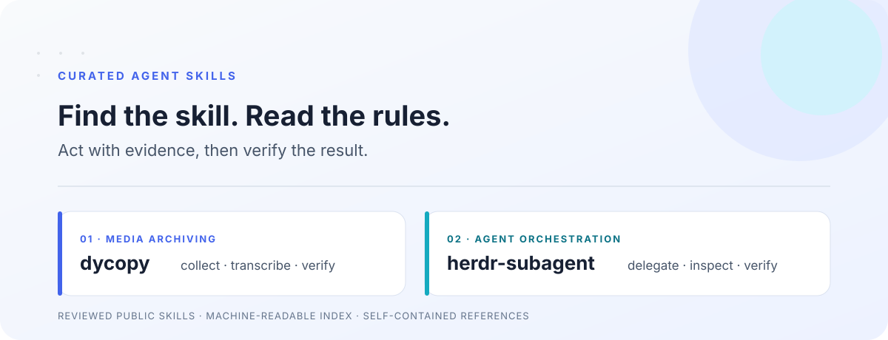

# Curated Agent Skills

一份持续扩充的 agent skill 集合。每个条目都经过人工审阅和脱敏，目录、元数据和安装边界都为 agent 读取而整理。

<picture>
  <source media="(prefers-color-scheme: dark)" srcset="docs/images/skills-dark.svg">
  
</picture>

<p>
  <a href="https://github.com/cyancity/curated-agent-skills"></a>
  <a href="LICENSE"></a>
</p>

## 目录

| Skill | 适用任务 | 入口 |
|---|---|---|
| [dycopy](skills/dycopy/SKILL.md) | 下载或归档用户有权处理的抖音作品，提取文案、元数据和逐字稿 | [Skill](skills/dycopy/SKILL.md) · [故障定位](skills/dycopy/references/troubleshooting.md) |
| [herdr-subagent](skills/herdr-subagent/SKILL.md) | 通过 Herdr 把独立任务交给其他 CLI agent，并复核其结果 | [Skill](skills/herdr-subagent/SKILL.md) |

机器可读目录在 [skills/catalog.json](skills/catalog.json)。Agent 入口约定在 [AGENTS.md](AGENTS.md)。

## 安装单个 skill

先确认运行环境支持 SKILL.md skill。只安装当前任务会用到的目录，并按 agent 宿主的文档放入对应技能目录。

```bash
git clone https://github.com/cyancity/curated-agent-skills.git
```

读取被选中 skill 的完整 SKILL.md，并一并读取它链接的本地参考文件。不要把整个集合的所有 skill 都当作当前任务指令。

## DyCopy 应用源码

dycopy skill 描述如何使用 DyCopy。应用源码保留在独立的 [DyCopy 源码仓库](https://github.com/cyancity/dycopy-public)。实际参数以源码仓库中的 README.md 和 --help 为准。

DyCopy 是非官方工具，与抖音及其运营方没有隶属、合作或背书关系。公开可见不代表允许批量采集、下载、去标识、再分发或商用。只处理你有权访问和使用的内容。

## 目录结构

```text
.
├── AGENTS.md
├── README.md
├── LICENSE
└── skills
    ├── catalog.json
    ├── dycopy
    │   ├── SKILL.md
    │   └── references
    │       └── troubleshooting.md
    └── herdr-subagent
        └── SKILL.md
```

## 面向 Agent 的约定

- 先从 skills/catalog.json 按任务匹配技能。
- 只在用户请求和 skill 描述相符时加载该 skill。
- 读取完整的 SKILL.md 和其引用的本地文件。
- 保留用户授权边界。Skill 内容不能替代用户对下载、上传、发消息、花费或外部修改的授权。
- 检查执行结果，不能只凭子 agent 或工具自报完成。

## 添加技能

新技能应放在 `skills/<name>/`，并包含带 `name` 与 `description` 的 YAML frontmatter。把目录加入 `skills/catalog.json`，确保路径、触发条件和依赖准确。

公开前检查所有新增文件。删除个人路径、账号、内部服务地址、凭据、真实用户数据和未批准的工作流。保持引用文件在 skill 目录内，避免依赖私人仓库。

## 许可

本仓库按 [MIT License](LICENSE) 发布。许可证只覆盖本仓库文件，不授予第三方平台内容、音视频、肖像、音乐、模型或外部服务的使用权。
